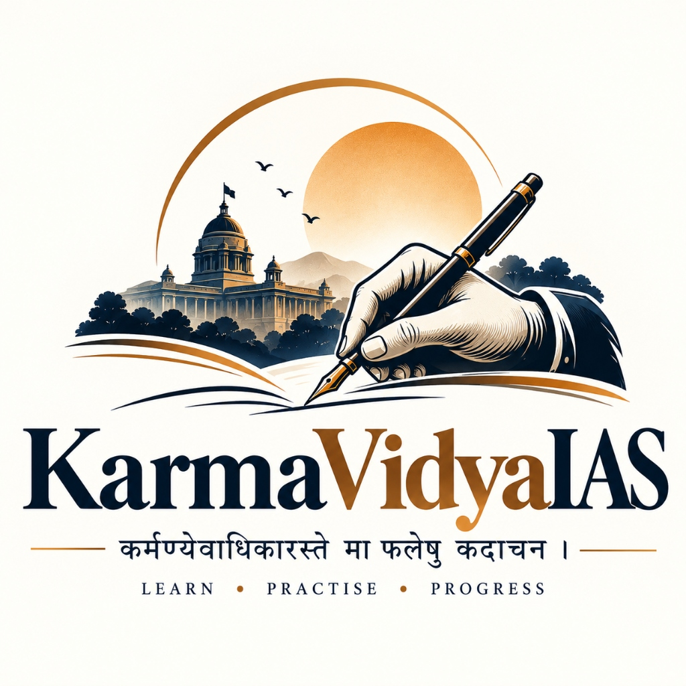
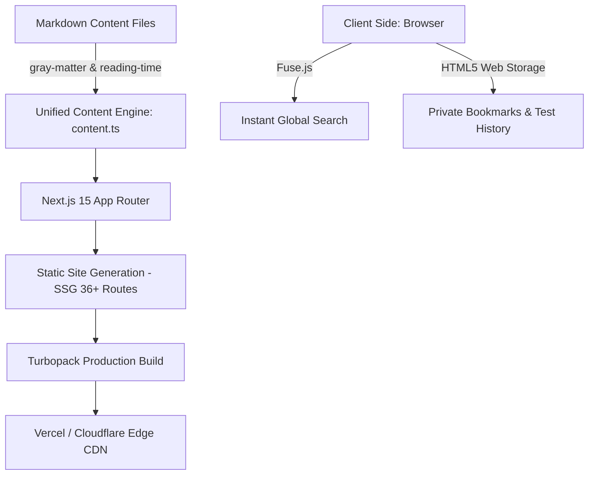

<div align="center">

  

  # KarmaVidyaIAS
  ### *A Complete, Free & Open UPSC Civil Services Learning Platform*

  <p align="center">
    <strong>कर्मण्येवाधिकारस्ते मा फलेषु कदाचन ।</strong><br/>
    <em>"You have a right to perform your prescribed duty, but you are not entitled to the fruits of action."</em><br/>
    <strong>LEARN &bull; PRACTISE &bull; PROGRESS</strong>
  </p>

  <p align="center">
    <a href="https://karmavidyaias.zybytee.in/" target="_blank"></a>
    <a href="https://nextjs.org"></a>
    <a href="https://www.typescriptlang.org"></a>
    <a href="https://tailwindcss.com"></a>
    <a href="https://jestjs.io"></a>
    
    
  </p>

  <p align="center">
    🚀 <strong>Official Live Website:</strong> <a href="https://karmavidyaias.zybytee.in/"><strong>https://karmavidyaias.zybytee.in/</strong></a>
  </p>

  <p align="center">
    <strong>100% Free</strong> &bull; <strong>No Paywalls</strong> &bull; <strong>No Registration Required</strong> &bull; <strong>Markdown-Driven</strong> &bull; <strong>Blazing Fast</strong>
  </p>

  <p align="center">
    <a href="#-about-the-mission">About</a> &bull;
    <a href="#-feature-matrix">Features</a> &bull;
    <a href="#-tech-stack--architecture">Tech Stack</a> &bull;
    <a href="#-folder-structure">Project Tree</a> &bull;
    <a href="#-getting-started">Quickstart</a> &bull;
    <a href="#-adding-content">Contribute Content</a> &bull;
    <a href="#-validation--testing">Testing</a> &bull;
    <a href="#-deployment">Deployment</a>
  </p>

</div>

---

## 🏛️ About the Mission

**KarmaVidyaIAS** is built on the timeless philosophy of *Nishkama Karma* (selfless, dedicated effort) and *Vidya* (the quest for true knowledge). 

As an independent UPSC Civil Services aspirant preparing for **CSE 2027**, I created this platform to:
1. **Practise Daily Answer Writing**: Publish rigorous, model answers for GS1, GS2, GS3, and GS4 every day.
2. **Democratize Quality UPSC Education**: Offer completely free, beautifully formatted notes, previous-year questions (PYQs), and timed mock tests with zero advertisements and zero sign-up friction.
3. **Build in Public with Open Standards**: Maintain content purely via transparent, version-controlled Markdown files that anyone can read, learn from, fork, and contribute to.

---

## 🌟 Feature Matrix

| Feature | Description | Highlight |
| :--- | :--- | :--- |
| **✍️ Mains Answer Bank** | Model answers for GS1, GS2, GS3, and GS4 with introductions, arguments, examples, flowcharts, and conclusions. | Reading time, word count, bookmarks, copy & print actions. |
| **🎯 Prelims PYQ Bank** | Real UPSC Prelims questions categorized by subject (Polity, Economy, History, Geography, Environment, Sci-Tech). | Instant option verification, detailed explanations, subject filters. |
| **⏱️ Mock Test Engine** | Full-fledged interactive test environment simulating actual UPSC Prelims conditions. | Live countdown timer, palette navigation, review flags, -0.66 negative marking. |
| **📖 Study Materials** | High-yield revision sheets and comparative constitutional/economic analysis. | Custom markdown tables, callout blocks, key facts. |
| **📰 Current Affairs** | Daily & monthly editorial breakdowns synthesized for civil services. | Prelims key pointers + Mains analytical hooks. |
| **🧠 Essay & Ethics Hub** | Dedicated sections for Paper-I (Essay outlines, quotes, PESTLE) and Paper-IV (Ethics frameworks & case studies). | Structured philosophical and governance themes. |
| **⚡ Global Fuzzy Search** | Instant client-side search powered by Fuse.js across all content types. | Keyboard shortcut `⌘K` / `Ctrl+K`, real-time results. |
| **📌 Local-First Bookmarks** | Save questions, answers, and revision sheets directly in your browser. | Zero account setup, privacy-first LocalStorage. |

---

## 🎨 Design System & Palette

KarmaVidyaIAS uses a tailored, distraction-free aesthetic crafted specifically for intense reading, retention, and revision:

```
┌────────────────────────────────────────────────────────────────────────┐
│  PRIMARY NAVY      #0B1E36   (Authority, Focus, Depth)                │
│  GOLDEN BRONZE     #B47B3B   (Vidya, Wisdom, Elevation)               │
│  SAFFRON ACCENT    #D97706   (Energy, Call to Action)                 │
│  SURFACE SLATE     #F8FAFC   (Soft, Eye-friendly Light Theme)         │
│  CARD BORDER       #E2E8F0   (Clean, Modern Card Contours)            │
│  TEXT INK          #0F172A   (Optimal Legibility & Typography)        │
└────────────────────────────────────────────────────────────────────────┘
```

- **Typography**: Paired with **Lora** (editorial serif for thought-provoking essay themes and question prompts) and **Inter** (clean, crisp sans-serif for UI controls, dashboards, and navigation).
- **Print Optimization**: Dedicated `@media print` stylesheets so any model answer can be printed to PDF cleanly without headers, sidebars, or distractions.

---

## 🛠️ Tech Stack & Architecture



- **Core Framework**: [Next.js 15+ (App Router)](https://nextjs.org/)
- **Programming Language**: [TypeScript 5](https://www.typescriptlang.org/) (Strict Mode)
- **Styling**: [Tailwind CSS 3.4](https://tailwindcss.com/) with `@tailwindcss/typography`
- **Content Parser**: [gray-matter](https://github.com/jonschlinkert/gray-matter) + custom AST `MarkdownRenderer`
- **Icons**: [Lucide React](https://lucide.dev/)
- **Fuzzy Search**: [Fuse.js](https://www.fusejs.io/)
- **Test Framework**: [Jest](https://jestjs.io/) + [tsx](https://github.com/privatenumber/tsx)

---

## 📂 Folder Structure

```text
KarmaVidyaIAS/
├── public/
│   ├── favicon.svg               # Crisp vector browser favicon
│   ├── logo.jpg                  # High-res emblem & brand crest
│   └── images/
│       └── karmavidya-ias-logo.jpg
├── content/                      # Content repository (Pure Markdown)
│   ├── current-affairs/          # Current affairs editorial breakdowns
│   ├── essays/                   # Philosophical & socio-economic essays
│   ├── mains-answers/            # GS1–GS4 daily practice model answers
│   ├── mock-tests/               # Timed mock test suites & questions
│   ├── prelims-pyq/              # Subject-wise Prelims PYQ banks
│   └── study-materials/          # High-yield revision notes
├── src/
│   ├── app/                      # Next.js 15 App Router pages
│   │   ├── about/                # Vision, philosophy & disclaimer
│   │   ├── bookmarks/            # Local storage saved items
│   │   ├── csat/                 # CSAT Paper-II strategy & guide
│   │   ├── current-affairs/      # Daily & monthly articles
│   │   ├── essay/                # Essay framework & outlines
│   │   ├── ethics/               # GS4 syllabus & case study models
│   │   ├── mains/                # Mains question bank & answer pages
│   │   ├── mock-tests/           # Timed interactive quiz engine
│   │   ├── prelims/              # PYQs by subject
│   │   ├── search/               # Global search interface
│   │   ├── study-materials/      # Subject notes & comparison tables
│   │   ├── syllabus/             # Official UPSC Prelims & Mains syllabus
│   │   └── upsc-guide/           # Exam pattern, strategy & roadmap
│   ├── components/               # Modular UI components
│   │   ├── content/              # MarkdownRenderer, MainsAnswer, PrelimsCard
│   │   ├── layout/               # Header with emblem, Responsive Nav, Footer
│   │   ├── search/               # Fuse.js client search overlay
│   │   ├── tests/                # Interactive MockTestEngine & Timer
│   │   └── ui/                   # Badges, buttons, breadcrumbs
│   ├── config/
│   │   └── site.ts               # Global site configuration & navigation
│   ├── lib/
│   │   ├── bookmarks.ts          # LocalStorage bookmark & test history engine
│   │   ├── content.ts            # High-performance Markdown content parser
│   │   ├── quiz.ts               # Scoring, timer formatting & negative marking
│   │   └── utils.ts              # Class merging & date formatting
│   └── types/                    # Strongly-typed TypeScript interfaces
├── scripts/
│   └── validate-content.ts       # Automated schema & integrity validator
├── __tests__/                    # Automated Jest unit test suites
│   ├── bookmarks.test.ts         # Bookmark & test history validation
│   ├── content.test.ts           # Slug resolving & metadata parsing
│   └── quiz.test.ts              # Scoring calculation & negative marking
├── package.json
├── tailwind.config.js
├── tsconfig.json
└── README.md
```

---

## 🚀 Getting Started

### Prerequisites

- **Node.js**: `v18.17.0` or higher (Node 20+ recommended)
- **npm** or **yarn** or **pnpm**

### Installation

1. **Clone the repository**:
   ```bash
   git clone https://github.com/abhishekkumarcoder21/KarmaVidyaIAS.git
   cd KarmaVidyaIAS
   ```

2. **Install dependencies**:
   ```bash
   npm install
   ```

3. **Start the development server**:
   ```bash
   npm run dev
   ```

4. **Open your browser**:
   Navigate to [http://localhost:3000](http://localhost:3000) to view the live platform.

---

## ✍️ Adding Content (Markdown Workflow)

Adding new content does not require database migrations or admin dashboards. Simply add a standard `.md` file to the corresponding folder in `content/`.

### 1. Adding a Mains Answer (`content/mains-answers/<slug>.md`)

```markdown
---
title: "Examine the significance of Constitutional Morality in Indian Democracy."
paper: "GS2"
subject: "Polity & Governance"
date: "2026-10-27"
year: 2026
marks: 15
wordLimit: 250
tags: ["Constitution", "Supreme Court", "Governance"]
slug: "significance-of-constitutional-morality"
questionText: "What do you understand by the term 'Constitutional Morality'? How has the judiciary applied this doctrine in landmark cases?"
---

### Introduction
Define Constitutional Morality with reference to Dr. B.R. Ambedkar's speech in the Constituent Assembly...

### Core Dimensions
1. **Rule of Law vs Popular Sentiment**: Upholding constitutional values over majoritarian impulse.
2. **Commitment to Fundamental Rights**: Protecting individual liberty and human dignity.

### Landmark Judicial Applications
- **Navtej Singh Johar (2018)**: Decriminalisation of Section 377.
- **Joseph Shine (2018)**: Striking down adultery as a criminal offence.
- **Sabarimala Case (2018)**: Upholding equality and biological dignity.

### Conclusion
A forward-looking concluding summary anchoring societal progress in constitutional values.
```

### 2. Validating Content Integrity

Run the automated validator to verify frontmatter types, date formats, and slug uniqueness:

```bash
npm run validate-content
```

---

## 🧪 Testing & Quality Assurance

KarmaVidyaIAS is built with production-grade test coverage:

```bash
# Run unit tests
npm test

# Run TypeScript type check
npm run type-check

# Run Next.js production build
npm run build
```

---

## 🌐 Deployment

### 🔗 Live Production Site
The platform is actively deployed and publicly accessible at:
👉 **[https://karmavidyaias.zybytee.in/](https://karmavidyaias.zybytee.in/)**

Because KarmaVidyaIAS generates 100% static HTML (SSG) via Next.js App Router, it can also be deployed for **free** on any modern CDN:

### Deploy with Vercel (Recommended)

1. Push your code to GitHub.
2. Import the repository into [Vercel](https://vercel.com).
3. The framework preset will automatically detect **Next.js**.
4. Click **Deploy** — your site will be live on an ultra-fast global Edge Network.

---

## 📜 Disclaimer & Philosophy

> **KarmaVidyaIAS** is an independent educational initiative maintained by an active UPSC CSE aspirant. Model answers represent personal daily practice and educational synthesis, not official UPSC answer keys. This website has no affiliation with or endorsement from the Union Public Service Commission (UPSC) or the Government of India.

---

## 📄 License

This project is open-source and released under the [MIT License](LICENSE).

<div align="center">
  <sub>Built with dedication for UPSC Civil Services Examination aspirants across Bharat 🇮🇳</sub><br/>
  <strong>KarmaVidyaIAS &copy; 2026 &bull; कर्मण्येवाधिकारस्ते मा फलेषु कदाचन ।</strong>
</div>